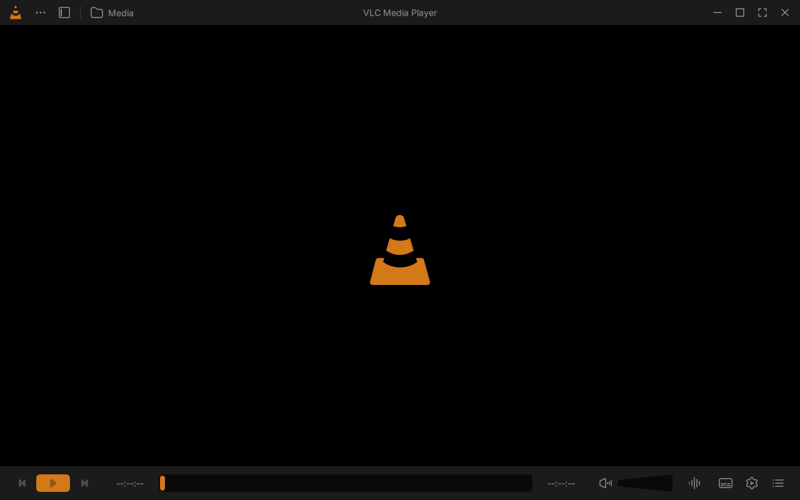
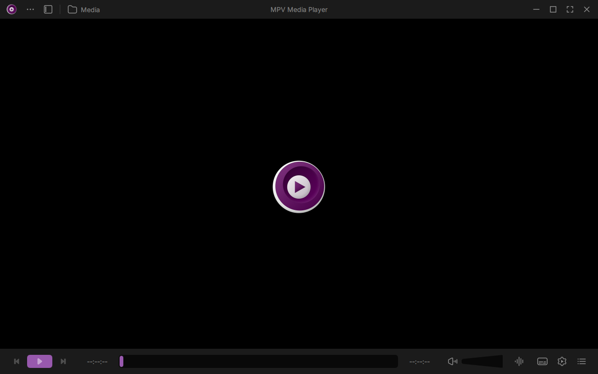
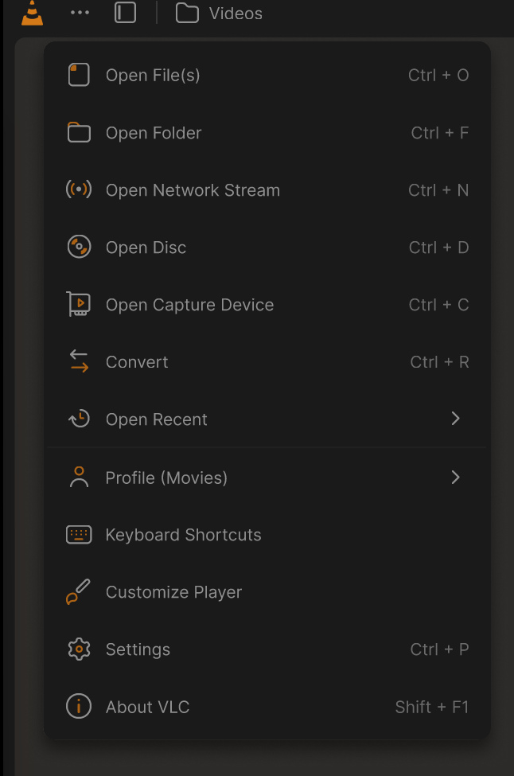
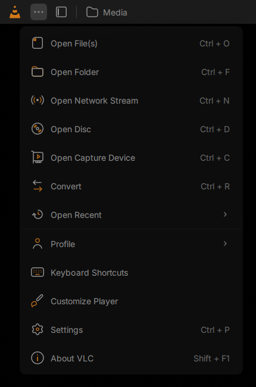
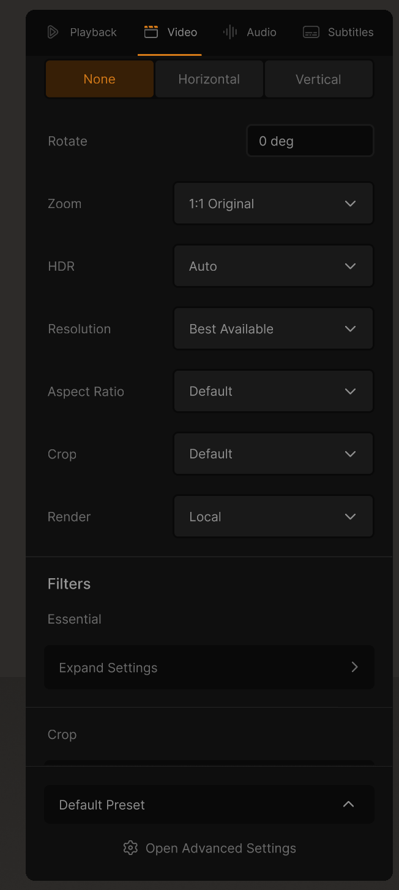
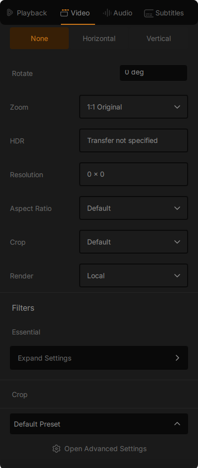
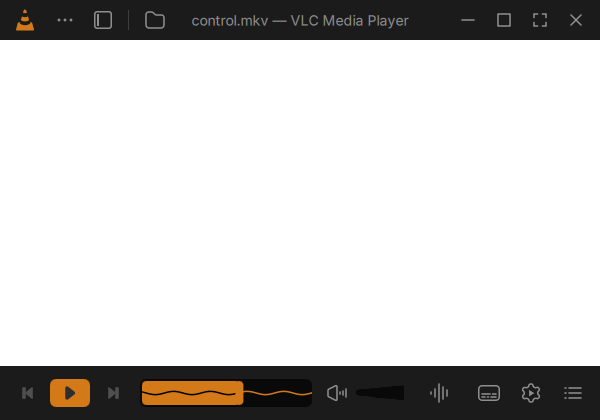

# Modern VLC Fork

A Windows desktop fork of VLC that brings Juxtopposed's redesign to a working
Qt/QML player, while retaining VLC's playback capabilities and an optional MPV
engine. This is an independent community fork, not an official VideoLAN release.

## Download

Get the Windows x64 portable package from the
[latest release](https://github.com/Darkaxt/vlc/releases/latest).
Extract the portable ZIP and run `vlc.exe`. Corresponding source, optional debug
symbols and SHA-256 checksums are provided separately with each release.
The portable package includes a native module index for its exact plugins, so
startup does not have to load every plugin DLL just to discover its metadata.
VLC still validates changed plugins normally.

During stabilization, Windows file diagnostics are enabled by default. With the
Log file field empty, timestamped logs go in `portable/logs` beside the player
(or the installed VLC profile's `logs` directory). Automatic logs expire after
three UTC calendar days (today and the preceding two), pruned at launch and daily
or size rotation, and retain at most eight 4 MiB files (32 MiB). No background
cleanup runs while the player is closed. Disable
**Settings → General → Save a log** to opt out; an explicit log filename remains
user-managed. Logs stay local and can include media paths/URLs. UTC timestamps,
process age and core startup phases help distinguish early loading from UI work.

## The player

| VLC engine | MPV engine |
| --- | --- |
|  |  |

Actual Qt player captures from an empty, isolated profile. Selecting an engine
also changes the title, accent and artwork, and saves the choice for the next
launch.

VLC and MPV have separate saved accent palettes in General Settings. Their
defaults are VLC orange and the MPV logo's purple; custom colors also tint the
running window and taskbar icon while preserving the original icon shading.
MPV display frames are derived from its original high-resolution artwork;
the Windows taskbar controls the displayed button size.

The volume wedge follows the saved accent for the active engine. Closing the floating miniplayer keeps playback running with the main window minimized.

- Redesigned player, media library, first-run guide and settings.
- VLC and MPV playback engines, with in-session switching that preserves position
  and play/pause state.
- MPV playback with integrated libplacebo/libdovi processing for supported
  Dolby Vision sources, converted to the verified Windows SDR output path.
- Seek previews and inline subtitle cue bands for supported text tracks, with
  cue navigation,50ms timing buttons and drag-to-sync inside the progress bar.
- Live VLC audio visualization inside the seekbar, with colors inverted across
  the playhead; unavailable engine/input combinations are identified explicitly.
- Native VLC specialist options remain available through Advanced Options and
  the searchable All VLC options view.

See the [specification](doc/redesign/SPECIFICATION.md),
[stage plan and verification](doc/redesign/PLAN.md) and
[reproduction instructions](doc/redesign/REPRODUCTION.md) for scope and evidence.

## Design and project credits

The interface is based on **Juxtopposed's**
[I Redesigned VLC After 25 Years](https://www.youtube.com/watch?v=ERFeOgqk324)
video and [interactive VLC Redesign Figma project](https://www.figma.com/community/file/1691465999134370980/vlc-redesign).
The original design is credited under
[CC BY 4.0](https://creativecommons.org/licenses/by/4.0/).
This implementation adapts it to working desktop controls, responsive layouts
and native settings; it also adds the engine switcher. Design attribution does
not replace the separate software, font and bundled dependency licenses.

### Reference and implementation

| Juxtopposed's Figma reference | Working player menu |
| --- | --- |
|  |  |

The comparison preserves the original menu order, two-tone icons and shortcuts.
The reference image is from the linked Figma project; the implementation image
is a cropped app-rendered capture. These captures show interface rendering,
without media or personal library content. See the [capture provenance](doc/redesign/screenshots/provenance.json).

| Figma Video panel | Working Video panel |
| --- | --- |
|  |  |

The four player-settings tabs use the original selected two-tone artwork with
the engine's saved accent. Section dividers, field sizes, flip segments,
synchronization sliders and the preset footer follow the reference. Values come
from the current media and engine; unsupported controls remain unavailable.
The native image is an exact crop of the rendered Qt interface.



The scope uses the playing audio stream. Its line changes from black over the
played accent fill to the active accent over the unplayed track.


Subtitle cues share the progress track: click to seek, drag a cue to synchronize,
or use the previous/next and timing buttons. This capture uses synthetic text
subtitles; the timeline follows the selected embedded or external text track.

The player builds on [VideoLAN VLC](https://www.videolan.org/vlc/),
[MPV](https://mpv.io/), [libplacebo](https://code.videolan.org/videolan/libplacebo)
and [libdovi](https://github.com/quietvoid/dovi_tool/tree/main/dolby_vision).
The Dolby Vision integration uses
[Darkaxt/mpv-android-libdovi](https://github.com/Darkaxt/mpv-android-libdovi)
as its source reference. The [resource index](doc/redesign/resources/README.md)
and release manifests record design assets, licenses and pinned runtime provenance.

## Upstream VLC

The original upstream project information follows.

**VLC** is a libre and open source **media player** and **multimedia engine**,
focused on **playing everything**, and **running everywhere**.

**VLC** can play most multimedia files, discs, streams, devices and is also able to
convert, encode, **stream** and manipulate streams into numerous formats.

VLC is used by many over the world, on numerous platforms, for very different use cases.

The **engine of VLC** can be embedded into 3rd party applications, and is called *libVLC*.

**VLC** is part of the [VideoLAN project](https://videolan.org) and
is developed and supported by a community of volunteers.

The VideoLAN project was started at the university [École Centrale Paris](https://www.centralesupelec.fr/) who
relicensed VLC under the GPLv2 license in February 2001. Since then, VLC has
been downloaded **billions** of times.

## License

**VLC** is released under the GPLv2 *(or later)* license.
*On some platforms, it is de facto GPLv3, because of the licenses of dependencies*.

**libVLC**, the engine is released under the LGPLv2 *(or later)* license. \
This allows embedding the engine in 3rd party applications, while letting them to be licensed under other licenses.

# Platforms

VLC is available for the following platforms:
- [Windows] *(from 7 and later, including UWP platforms and all versions of Windows 10)*
- [macOS] *(10.10 and later)*
- [GNU/Linux] and affiliated
- [BSD] and affiliated
- [Android] *(4.2 and later)*, including Android TV and Android Auto
- [iOS] *(9 and later)*, including AppleTV and iPadOS
- Haiku, OS/2 and a few others.

[Windows]: https://www.videolan.org/vlc/download-windows.html
[macOS]: https://www.videolan.org/vlc/download-macosx.html
[GNU/Linux]: https://www.videolan.org/vlc/#download
[BSD]: https://www.videolan.org/vlc/download-freebsd.html
[Android]: https://www.videolan.org/vlc/download-android.html
[iOS]: https://www.videolan.org/vlc/download-ios.html

Not all platforms receive the same amount of care, due to our limited resources.

**Nota Bene**: The [Android app](https://code.videolan.org/videolan/vlc-android/) and
the [iOS app](https://code.videolan.org/videolan/vlc-ios/) are located in different repositories
than the main one.

# Contributing & Community

**VLC** is maintained by a community of people, and VideoLAN is not paying any of them.\
The community is composed of developers, helpers, maintainers, designers and writers that want
this open source project to thrive.

The main development of VLC is done in the C language, but this repository also contains
plenty of C++, Obj-C, asm and Rust.

Other repositories linked to vlc are done in languages including Kotlin/Java [(Android)](https://code.videolan.org/videolan/vlc-android/),
Swift [(iOS)](https://code.videolan.org/videolan/vlc-ios/), and C# [(libVLCSharp)](https://code.videolan.org/videolan/libvlcsharp/).

We need help with the following tasks:
- Coding
- Packaging for Windows, macOS and Linux distributions
- Technical writing for the documentation
- Design
- Support
- Community management and communication.

Please contribute :)

We are on IRC. You can find us on the **#videolan** channel on *[Libera.chat]*.

[Libera.chat]: https://libera.chat

## Contributions

Contributions are now done through Merge Requests on our [GitLab repository](https://code.videolan.org/videolan/vlc/).

CI and discussions should be resolved before a Merge Request can be merged.

# libVLC

**libVLC** is an embeddable engine for 3rd party applications and frameworks.

It runs on the same platforms as VLC *(and sometimes on more)* and can provide playback,
streaming and conversion of multimedia files and streams.


**libVLC** has numerous bindings for other languages, such as C++, Python and C#.

# Support

## Links

Some useful links that might help you:

- [VLC web site](https://www.videolan.org/vlc/)
- [Support](https://www.videolan.org/support/)
- [Forums](https://forum.videolan.org/)
- [Wiki](https://wiki.videolan.org/)
- [Developer's Corner](https://wiki.videolan.org/Developers_Corner)
- [VLC hacking guide](https://wiki.videolan.org/Hacker_Guide)
- [Bugtracker](https://code.videolan.org/videolan/vlc/-/issues)
- [VideoLAN web site](https://www.videolan.org/)

## Source Code sitemap
```
ABOUT-NLS          - Notes on the Free Translation Project.
AUTHORS            - VLC authors.
COPYING            - The GPL license.
COPYING.LIB        - The LGPL license.
INSTALL            - Installation and building instructions.
NEWS               - Important modifications between the releases.
README             - Project summary.
THANKS             - VLC contributors.

bin/               - VLC binaries.
bindings/          - libVLC bindings to other languages.
compat/            - compatibility library for operating systems missing
                     essential functionalities.
contrib/           - Facilities for retrieving external libraries and building
                     them for systems that don't have the right versions.
doc/               - Miscellaneous documentation.
extras/analyser    - Code analyser and editor specific files.
extras/buildsystem - Different build system specific files.
extras/misc        - Files that don't fit in the other extras/ categories.
extras/package     - VLC packaging specific files such as spec files.
extras/tools/      - Facilities for retrieving external building tools needed
                     for systems that don't have the right versions.
include/           - Header files.
lib/               - libVLC source code.
modules/           - VLC plugins and modules. Most of the code is here.
po/                - VLC translations.
share/             - Common resource files.
src/               - libvlccore source code.
test/              - Testing system.
```
